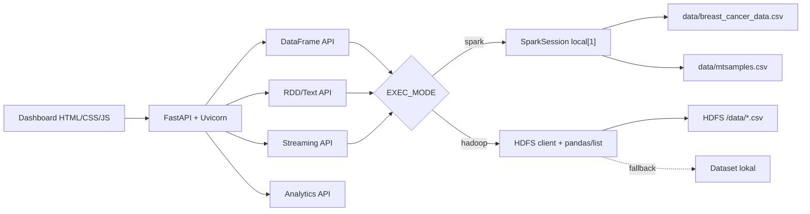

# Hybrid Spark & Hadoop Dashboard

Dashboard analitik data medis berbasis **FastAPI**, **Apache Spark**, dan
**Hadoop HDFS**. Aplikasi menyediakan antarmuka web dan REST API untuk:

- memfilter data pasien kanker;
- menampilkan preview dataset terstruktur dan tidak terstruktur;
- mencari kata kunci pada laporan patologi;
- menerima data pasien dan teks patologi secara real-time;
- membandingkan waktu pemrosesan antar-engine secara in-memory.

> Proyek ini ditujukan untuk demonstrasi/laboratorium. Belum tersedia
> autentikasi, database aplikasi, persistence data streaming, atau konfigurasi
> production.

## Arsitektur



### Komponen utama

| Komponen | Tanggung jawab |
|---|---|
| `main.py` | Membuat aplikasi FastAPI, memilih engine, memuat dataset, dan menyajikan halaman web |
| `routers/dataframe_api.py` | Filter dan preview data pasien |
| `routers/rdd_api.py` | Pencarian dan preview laporan patologi |
| `routers/stream_api.py` | Ingest data pasien/teks dan statistik streaming |
| `routers/analytics_api.py` | Ringkasan waktu eksekusi per operasi dan mode |
| `static/index.html` | Dashboard utama dan monitor real-time |
| `static/tables.html` | Preview 100 baris data pasien dan patologi |
| `stream_producer.py` | Simulator pengiriman data melalui HTTP |
| `lab_engine.py` | Engine Clinical Laboratory Analytics untuk `data2/`: load, pembersihan, standarisasi satuan, query (Spark atau pandas/HDFS) |
| `routers/lab_api.py` | Endpoint `/api/lab/*` (Volume, Velocity, Veracity, Value) |
| `lab_batch_producer.py` | Simulator kedatangan batch hasil laboratorium (Velocity) |
| `static/lab.html` | Dashboard lab di `/lab` |
| `docker-compose.yml` | NameNode dan DataNode HDFS minimal |

Pada mode Spark, `main.py` membuat `SparkSession` dengan `local[1]`,
memuat `mtsamples.csv` sebagai `RDD[String]`, dan membuat temporary view
`patients` dari `breast_cancer_data.csv`. Pada mode Hadoop, file dibaca
melalui `hdfs.InsecureClient` dan diproses menggunakan list Python serta
pandas. Jika HDFS gagal diakses dan kedua CSV tersedia secara lokal, aplikasi
menggunakan dataset lokal sebagai fallback.

## Struktur Proyek

```text
.
├── data/
│   ├── breast_cancer_data.csv       # Dataset kanker tabular
│   └── mtsamples.csv                # Dataset laporan patologi
├── data2/
│   ├── lab_results_batch_1..5.json  # Data batch laboratorium tambahan
│   └── patient_encounters - Copy.csv
├── routers/
│   ├── lab_api.py
│   ├── analytics_api.py
│   ├── dataframe_api.py
│   ├── rdd_api.py
│   └── stream_api.py
├── static/
│   ├── index.html
│   ├── lab.html
│   └── tables.html
├── docker-compose.yml
├── main.py
├── lab_engine.py
├── lab_batch_producer.py
├── stream_producer.py
└── README.md
```

Dataset pada `data2/` diproses oleh modul Clinical Laboratory Analytics
(`lab_engine.py` + `routers/lab_api.py`), lihat bagian
[Clinical Laboratory Analytics](#clinical-laboratory-analytics-data2).

## Dataset

### `data/breast_cancer_data.csv`

Dataset tabular dengan kolom `id`, `diagnosis`, `radius_mean`, serta fitur
tumor lain seperti `texture_mean`, `perimeter_mean`, `area_mean`,
`smoothness_mean`, dan fitur `*_worst`. Nilai diagnosis umumnya:

- `M`: malignant;
- `B`: benign.

### `data/mtsamples.csv`

Dataset teks laporan medis dengan kolom seperti `description`,
`medical_specialty`, `sample_name`, `transcription`, dan `keywords`.
Pada mode Spark, file ini dibaca per baris sebagai RDD. Pada mode Hadoop,
isinya dimuat sebagai list baris.

### `data2/`

Berisi lima batch hasil laboratorium JSON Lines (20.000 record per batch,
JSON bersarang) dan satu CSV patient encounters (20.000 baris). Seluruh data
bersifat sintetis. Disarankan mengganti nama CSV menjadi
`patient_encounters.csv` (nama lama `patient_encounters - Copy.csv` tetap
dikenali sebagai fallback).

## Clinical Laboratory Analytics (data2)

Studi kasus midterm IFB-451: **Clinical Laboratory Data Analytics**. Alurnya
sama dengan pemrosesan folder `data/`, dengan dua engine yang dipilih oleh
`EXEC_MODE`:

```text
data2/ (landing zone) -> load/ingest -> clean + standardise -> query -> /api/lab/* + /lab
```

| EXEC_MODE | Engine | Sumber data |
|---|---|---|
| `spark` | PySpark DataFrame + Spark SQL (`SparkLabStore`) | `data2/` lokal |
| `hadoop` | `hdfs.InsecureClient` + pandas (`PandasLabStore`) | HDFS `/data2/`, fallback `data2/` lokal |

Encounters (CSV) dimuat sekali saat startup. Hasil laboratorium (JSON Lines)
masuk per batch lewat `POST /api/lab/batches` (simulasi kedatangan periodik)
atau sekaligus lewat `POST /api/lab/load-all`.

### Aturan kualitas data (Veracity)

| Masalah di data | Penanganan | `quality_flag` |
|---|---|---|
| `lab_record_id` / `encounter_id` duplikat | dedup (dalam batch dan lintas batch) | - |
| `result_value = null` | dikecualikan dari analitik | `PENDING_RESULT` |
| `result_value = ""` | dikecualikan | `READ_ERROR` |
| `result_value = -999` (sentinel) | dikecualikan | `CALIBRATION_ERROR` |
| Timestamp hasil sebelum admission | dikecualikan | `TIMESTAMP_BEFORE_ADMISSION` |
| Satuan campuran | glukosa mmol/L x 18,016 -> mg/dL; kreatinin umol/L / 88,4 -> mg/dL | - |

Hanya baris `quality_flag = OK` yang masuk analitik. Dari 100.000 record mentah:
3.000 duplikat dibuang, 6.000 dikecualikan, 91.000 valid.

### Endpoint `/api/lab`

| Endpoint | 5V | Fungsi |
|---|---|---|
| `GET /overview` | Volume | Jumlah record, ukuran file, relasi, join match rate |
| `POST /load-all` | Volume | Bulk load semua batch dan ukur waktunya |
| `POST /batches` | Velocity | Terima satu batch (`{batch_id, sent_at, records[]}`) |
| `GET /batches` | Velocity | Log kedatangan, inter-arrival, latensi parse/clean/total |
| `GET /quality` | Veracity | Before/after tiap masalah kualitas |
| `GET /analysis/simple` | Value | Operasi A: encounter per departemen |
| `GET /analysis/relational` | Value | Operasi B: join lab x encounters, per departemen/hari/diagnosis |
| `GET /analysis/compare?repeats=3` | Volume | Waktu A vs B |
| `GET /preview?limit=&flag=` | Variety | Record terintegrasi beserta `quality_flag` |
| `POST /reset` | - | Kosongkan data lab (untuk mengulang demo) |

### Menjalankan

```powershell
$env:EXEC_MODE = "spark"
python -m uvicorn main:app
# terminal lain: simulasi kedatangan batch (SIMULASI, bukan LIS asli)
python lab_batch_producer.py --reset --interval 5
# buka http://localhost:8000/lab
```

Untuk HDFS: salin `data2/` ke HDFS (`/data2`), lalu jalankan dengan
`EXEC_MODE=hadoop`. Kolom `landing_zone.source` pada `/api/lab/overview`
menunjukkan apakah data benar-benar terbaca dari `hdfs` atau jatuh ke `local`.

Catatan teknis: `SparkLabStore` menurunkan `spark.sql.shuffle.partitions`
menjadi 8 (variabel `SPARK_SHUFFLE_PARTITIONS`) dan memakai
`localCheckpoint()` untuk memutus lineage antar batch.

## Prasyarat dan Instalasi

- Python 3.10 atau lebih baru;
- Java yang kompatibel dengan versi PySpark;
- Docker Desktop dan Docker Compose, hanya untuk mode HDFS;
- Windows: PySpark mungkin memerlukan konfigurasi Java/Hadoop tambahan,
  tergantung versi lingkungan lokal.

Repository belum menyediakan `requirements.txt` atau `pyproject.toml`.
Instal dependency secara manual di virtual environment:

```powershell
python -m venv venv
.\venv\Scripts\Activate.ps1
python -m pip install --upgrade pip
pip install fastapi uvicorn pandas pyspark hdfs requests
```

Jika PowerShell memblokir aktivasi:

```powershell
Set-ExecutionPolicy -Scope Process -ExecutionPolicy Bypass
.\venv\Scripts\Activate.ps1
```

## Menjalankan Aplikasi

Jalankan dari root repository. `EXEC_MODE` membaca mode dari environment
variable dan default-nya adalah `hadoop`.

### Mode Spark

Mode ini paling sederhana untuk demonstrasi karena menggunakan dataset lokal:

```powershell
$env:EXEC_MODE = "spark"
python -m uvicorn main:app --reload
```

### Mode Hadoop

```powershell
$env:EXEC_MODE = "hadoop"
python -m uvicorn main:app --reload
```

Mode Hadoop mencoba membaca `/data/mtsamples.csv` dan
`/data/breast_cancer_data.csv` dari HDFS. Jika HDFS tidak tersedia, aplikasi
akan memakai file pada `data/` apabila keduanya ada.

> Nilai `EXEC_MODE` yang didukung adalah `spark` dan `hadoop`. Nilai lain tidak
> menginisialisasi engine dan dapat menyebabkan endpoint gagal.

Halaman yang tersedia:

| URL | Fungsi |
|---|---|
| <http://localhost:8000/> | Dashboard utama |
| <http://localhost:8000/tables> | Preview dataset |
| <http://localhost:8000/docs> | Swagger UI |
| <http://localhost:8000/redoc> | ReDoc |
| <http://localhost:8000/api/mode> | Mode dan engine aktif |

## API Reference

Semua endpoint mengembalikan JSON. Kegagalan pemrosesan dikembalikan sebagai
HTTP `500` dengan field `detail`.

### Mode

#### `GET /api/mode`

Mengembalikan mode aktif dan nama engine:

```json
{
  "mode": "spark",
  "engine": "Apache Spark (SQL/RDD)"
}
```

### Data pasien

#### `GET /api/patients/filter`

| Parameter | Tipe | Default | Keterangan |
|---|---|---:|---|
| `min_radius` | float | `20.0` | Nilai minimum `radius_mean` |
| `diag_type` | string | `M` | Diagnosis yang dicari |

Response berisi `mode`, `execution_time_sec`, `total_found`, dan `data`.
Pada mode Spark, query memakai temporary view `patients`; pada mode Hadoop,
filter dilakukan pada pandas DataFrame.

#### `GET /api/patients/all`

| Parameter | Tipe | Default | Keterangan |
|---|---|---:|---|
| `limit` | integer | `100` | Jumlah baris maksimum |

Response berisi `mode`, `columns`, dan `data`. Kolom yang diawali `Unnamed`
dihilangkan dari output.

### Laporan patologi

#### `GET /api/pathology/search`

| Parameter | Tipe | Default | Keterangan |
|---|---|---:|---|
| `keyword` | string | `cancer` | Pencarian tanpa membedakan kapitalisasi |

Response berisi `mode`, `execution_time_sec`, `keyword`, `total_found`, dan
maksimal 50 baris pada `data`. Pada mode Spark, implementasi saat ini
mengambil seluruh RDD ke driver dengan `collect()` sebelum pencarian.

#### `GET /api/pathology/all`

| Parameter | Tipe | Default | Keterangan |
|---|---|---:|---|
| `limit` | integer | `100` | Jumlah baris maksimum |

Response berisi `mode` dan `data`.

### Streaming

#### `POST /api/stream/patient`

Menerima payload JSON pasien. Field utama:

```json
{
  "id": 900001,
  "diagnosis": "M",
  "radius_mean": 20.5,
  "texture_mean": 15.0,
  "perimeter_mean": 120.0,
  "area_mean": 1000.0,
  "extra_features": {
    "custom_field": "optional"
  }
}
```

`id` bersifat opsional dan dibuat otomatis jika tidak dikirim. Field
`extra_features` digabungkan ke record sebelum disimpan.

#### `POST /api/stream/pathology`

Payload minimal:

```json
{
  "text": "Malignant carcinoma cells observed.",
  "sample_name": "Live Stream Sample",
  "medical_specialty": "Pathology"
}
```

#### `GET /api/stream/status`

Mengembalikan jumlah data, latensi ingest per mode, riwayat streaming terbaru,
dan catatan perbandingan engine. Riwayat disimpan dalam buffer maksimum 50
item, sedangkan response mengembalikan maksimal 15 item terbaru.

Data streaming hanya disimpan di memori proses FastAPI. Data tidak ditulis
kembali ke file CSV atau HDFS dan akan hilang saat proses restart.

### Analytics

#### `GET /api/analytics/execution-summary`

Mengembalikan jumlah, rata-rata, dan waktu eksekusi terakhir untuk operasi
`filter_data`, `cari_teks`, dan `stream_ingest`, dikelompokkan berdasarkan mode
`spark` dan `hadoop`. Metrik juga hanya tersimpan di memori proses.

## Contoh Pemanggilan API

```powershell
# Mode aktif
curl http://localhost:8000/api/mode

# Filter pasien malignant dengan radius minimum 20
curl "http://localhost:8000/api/patients/filter?min_radius=20&diag_type=M"

# Ambil 10 pasien
curl "http://localhost:8000/api/patients/all?limit=10"

# Cari keyword pada laporan patologi
curl "http://localhost:8000/api/pathology/search?keyword=tumor"

# Ambil 20 baris laporan
curl "http://localhost:8000/api/pathology/all?limit=20"

# Kirim satu data pasien
curl -X POST http://localhost:8000/api/stream/patient `
  -H "Content-Type: application/json" `
  -d '{\"diagnosis\":\"M\",\"radius_mean\":21.2}'

# Lihat statistik streaming
curl http://localhost:8000/api/stream/status
```

## Simulasi Streaming

`stream_producer.py` membaca data referensi dari kedua CSV pada `data/`, lalu
mengirimkannya ke API streaming melalui HTTP. Jalankan di terminal terpisah
setelah server aktif:

```powershell
# Pasien dan patologi, tanpa batas sampai CTRL+C
python stream_producer.py

# Interval satu detik
python stream_producer.py --interval 1.0

# Hanya pasien, kirim 50 record
python stream_producer.py --type patients --count 50 --interval 2.0

# Hanya teks patologi
python stream_producer.py --type pathology --count 20

# Target server berbeda
python stream_producer.py --target http://localhost:8001
```

Argumen yang tersedia:

| Argumen | Default | Nilai |
|---|---|---|
| `--target` | `http://localhost:8000` | Base URL FastAPI |
| `--interval` | `1.5` | Jeda antar pengiriman dalam detik |
| `--type` | `both` | `patients`, `pathology`, atau `both` |
| `--count` | `0` | Jumlah data; `0` berarti tanpa batas |

Dashboard utama menyediakan polling status stream dan menampilkan waktu
ingest server serta round-trip time dari simulator.

## Menjalankan Hadoop HDFS dengan Docker

Compose hanya menjalankan HDFS minimal:

| Service | Peran | Port host |
|---|---|---|
| `namenode` | Metadata HDFS, RPC, Web UI/WebHDFS | `9870`, `9000` |
| `datanode` | Penyimpanan blok data | `9864` |

Tidak ada YARN, Spark Master, atau Spark Worker dalam konfigurasi ini.

```powershell
docker compose up -d
docker compose ps
```

Salin dataset dari host ke container lalu masukkan ke HDFS:

```powershell
docker cp data\mtsamples.csv namenode:/tmp/mtsamples.csv
docker cp data\breast_cancer_data.csv namenode:/tmp/breast_cancer_data.csv
docker exec namenode hdfs dfs -mkdir -p /data
docker exec namenode hdfs dfs -put -f /tmp/mtsamples.csv /data/
docker exec namenode hdfs dfs -put -f /tmp/breast_cancer_data.csv /data/
docker exec namenode hdfs dfs -ls /data
```

NameNode Web UI tersedia di <http://localhost:9870>. Hentikan container
dengan:

```powershell
docker compose down
```

Named volume `hadoop_namenode` menyimpan metadata NameNode dan
`hadoop_datanode` menyimpan blok DataNode. Direktori host `data/` tidak
otomatis dimount ke container.

## Catatan Teknis dan Batasan

- `local[1]` dipilih untuk mengurangi masalah kompatibilitas PySpark di
  Windows; ini bukan deployment cluster Spark.
- Konversi `toPandas()` dan response JSON cocok untuk preview kecil, bukan
  untuk mengirim seluruh dataset besar.
- Pencarian patologi mode Spark memakai `collect()`, sehingga seluruh RDD
  dapat masuk ke memori driver sebelum hasil dibatasi menjadi 50 baris.
- Query filter Spark menggunakan interpolasi string SQL. Untuk deployment
  production, parameter perlu divalidasi dan query perlu dibangun dengan cara
  yang lebih aman.
- Tidak ada persistence, autentikasi, pembatasan akses, atau logging terpusat.
- Tidak tersedia test suite, dependency lockfile, maupun file lisensi di
  repository saat ini.

## Lisensi

Repository ini belum menyertakan berkas lisensi. Tambahkan lisensi eksplisit
sebelum proyek didistribusikan di luar kebutuhan internal atau pembelajaran.
