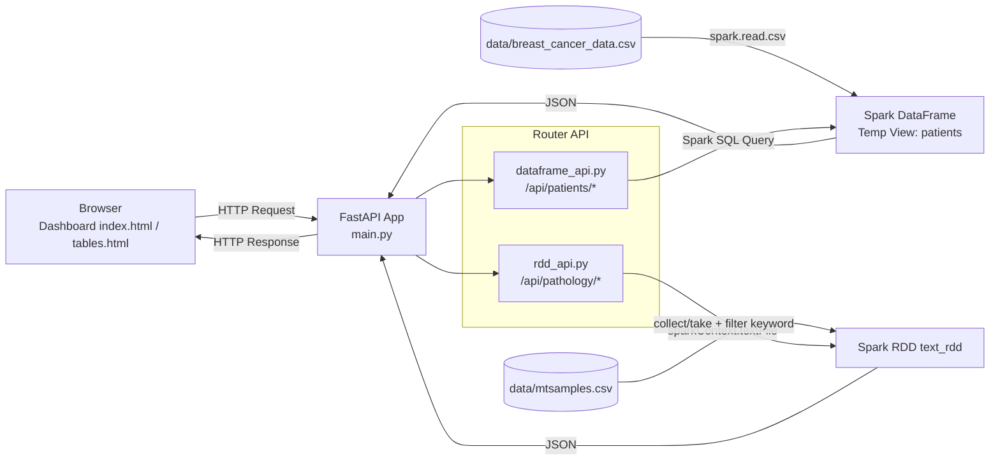

# Big Data Apache Spark - Spark Analytics Dashboard

Dashboard analitik medis berbasis **FastAPI + Apache Spark (PySpark)** untuk mengeksplorasi dua tipe data:
- **Data terstruktur** pasien kanker payudara (CSV) melalui API berbasis Spark SQL/DataFrame.
- **Data tidak terstruktur** transkrip patologi medis (CSV) melalui API berbasis RDD.

Aplikasi menyediakan antarmuka web untuk filter data pasien, pencarian kata kunci pada teks patologi, serta tampilan tabel raw data.

## Daftar Isi
- [Tujuan, Ruang Lingkup, dan Use Case](#tujuan-ruang-lingkup-dan-use-case)
- [Fitur Utama](#fitur-utama)
- [Arsitektur Sistem](#arsitektur-sistem)
- [Struktur Direktori Penting](#struktur-direktori-penting)
- [Prasyarat](#prasyarat)
- [Instalasi dan Setup](#instalasi-dan-setup)
- [Menjalankan Aplikasi](#menjalankan-aplikasi)
- [Endpoint API](#endpoint-api)
- [Alur Pemrosesan Data](#alur-pemrosesan-data)
- [Konfigurasi & Environment Variable](#konfigurasi--environment-variable)
- [Output yang Diharapkan](#output-yang-diharapkan)
- [Troubleshooting](#troubleshooting)
- [Panduan Kontribusi](#panduan-kontribusi)
- [Lisensi](#lisensi)
- [Catatan Proyek](#catatan-proyek)

## Tujuan, Ruang Lingkup, dan Use Case
### Tujuan
Mendemonstrasikan pemrosesan data big data skala kecil dengan Spark menggunakan dua pendekatan utama:
1. **Spark SQL/DataFrame** untuk query data tabular.
2. **Spark RDD** untuk pencarian teks bebas pada dokumen medis.

### Ruang Lingkup
- Menjalankan server FastAPI yang menyiapkan SparkSession.
- Memuat dua dataset dari folder `data/`.
- Menyediakan endpoint API untuk filter dan preview data.
- Menyediakan UI dashboard sederhana pada folder `static/`.

### Use Case
- Analisis cepat pasien berdasarkan `diagnosis` dan ambang `radius_mean`.
- Pencarian kata medis pada dokumen transkrip patologi.
- Preview data mentah untuk validasi isi dataset.

## Fitur Utama
- **Dashboard web**: `GET /` menampilkan halaman analitik (`static/index.html`).
- **Halaman tabel data**: `GET /tables` menampilkan preview data mentah (`static/tables.html`).
- **API DataFrame** (`/api/patients`):
  - Filter pasien dengan parameter `min_radius` dan `diag_type`.
  - Ambil seluruh data pasien dengan limit.
- **API RDD** (`/api/pathology`):
  - Cari kata kunci dalam teks patologi.
  - Ambil baris data teks mentah dengan limit.
- **Metrik respons**: beberapa endpoint mengembalikan `execution_time_sec`.

## Arsitektur Sistem


## Struktur Direktori Penting
```text
big-data-apache-spark/
├── main.py
├── routers/
│   ├── __init__.py
│   ├── dataframe_api.py
│   └── rdd_api.py
├── data/
│   ├── breast_cancer_data.csv
│   └── mtsamples.csv
└── static/
    ├── index.html
    └── tables.html
```

## Prasyarat
- Python 3.9+ (disarankan Python 3.10 atau lebih baru)
- Java Runtime (dibutuhkan oleh Apache Spark/PySpark)
- Paket Python:
  - `fastapi`
  - `uvicorn`
  - `pyspark`

## Instalasi dan Setup
Dari root repositori:

```bash
cd /home/runner/work/big-data-apache-spark/big-data-apache-spark
python -m venv .venv
source .venv/bin/activate  # Linux/macOS
pip install --upgrade pip
pip install fastapi uvicorn pyspark
```

> Catatan: repositori ini tidak menyertakan file `requirements.txt`, sehingga instalasi dependency dilakukan manual.

## Menjalankan Aplikasi
Jalankan server FastAPI dengan Uvicorn dari root repositori:

```bash
uvicorn main:app --host 0.0.0.0 --port 8000 --reload
```

Akses aplikasi:
- Dashboard utama: `http://localhost:8000/`
- Tabel raw data: `http://localhost:8000/tables`
- Dokumentasi OpenAPI (otomatis dari FastAPI): `http://localhost:8000/docs`

## Endpoint API
| Endpoint | Method | Query Param | Deskripsi Respons |
|---|---|---|---|
| `/api/patients/filter` | GET | `min_radius` (float, default `20.0`), `diag_type` (string, default `"M"`) | Data pasien (`id`, `diagnosis`, `radius_mean`), `execution_time_sec`, `total_found` |
| `/api/patients/all` | GET | `limit` (int, default `100`) | Semua kolom pada view `patients` dalam batas `limit` |
| `/api/pathology/search` | GET | `keyword` (string, default `"cancer"`) | Baris teks yang memuat keyword (maks 50 baris), `execution_time_sec` |
| `/api/pathology/all` | GET | `limit` (int, default `100`) | Preview baris teks dari RDD |

Contoh pemanggilan:

```bash
curl "http://localhost:8000/api/patients/filter?min_radius=20&diag_type=M"
curl "http://localhost:8000/api/pathology/search?keyword=tumor"
```

## Alur Pemrosesan Data
1. Saat aplikasi start, `main.py` membuat `SparkSession`.
2. File `data/breast_cancer_data.csv` dibaca sebagai DataFrame, lalu didaftarkan sebagai temp view `patients`.
3. File `data/mtsamples.csv` dibaca sebagai RDD teks (`text_rdd`).
4. Router DataFrame menjalankan SQL query ke view `patients` untuk filter/preview data.
5. Router RDD mengambil baris teks (`collect`/`take`) lalu melakukan pencarian keyword di sisi Python.
6. Hasil dikirim sebagai JSON dan dirender oleh frontend (`static/index.html` dan `static/tables.html`).

## Konfigurasi & Environment Variable
- `PYSPARK_PYTHON` di-set ke `python` langsung di `main.py`:

```python
os.environ["PYSPARK_PYTHON"] = "python"
```

- Tidak ada file konfigurasi `.env` atau variable environment tambahan yang didefinisikan khusus di repositori ini.

## Output yang Diharapkan
Jika aplikasi berjalan normal:
- Halaman dashboard menampilkan:
  - tabel hasil filter pasien,
  - metrik waktu eksekusi,
  - hasil pencarian teks patologi.
- Halaman `/tables` menampilkan preview data DataFrame dan RDD (default 100 baris).
- Endpoint API mengembalikan JSON sesuai kontrak pada tabel endpoint.

## Troubleshooting
- **`ModuleNotFoundError: No module named 'fastapi'/'pyspark'/'uvicorn'`**  
  Pastikan virtual environment aktif dan dependency sudah di-install.

- **Spark gagal start / Java error (`JAVA_HOME` atau `java` tidak ditemukan)**  
  Pastikan Java sudah terpasang dan dapat diakses dari terminal (`java -version`).

- **File data tidak ditemukan (`data/*.csv`)**  
  Jalankan perintah dari root repositori agar path relatif pada `main.py` valid.

- **Port 8000 sudah dipakai**  
  Jalankan pada port lain, misalnya `--port 8001`.

## Panduan Kontribusi
1. Fork/clone repositori.
2. Buat branch fitur/perbaikan.
3. Lakukan perubahan kecil dan terfokus.
4. Jalankan aplikasi dan uji endpoint yang terdampak.
5. Buat commit yang deskriptif, lalu ajukan Pull Request.

## Lisensi
Lisensi **belum ditentukan** (file lisensi tidak ditemukan di repositori saat dokumentasi ini dibuat).

## Catatan Proyek
- Repositori ini berfokus pada demonstrasi integrasi FastAPI dengan Spark untuk data terstruktur dan teks.
- Implementasi pada router RDD memproses pencarian keyword setelah data ditarik ke Python (`collect`), sehingga cocok untuk demo/eksplorasi, bukan workload produksi skala sangat besar.
