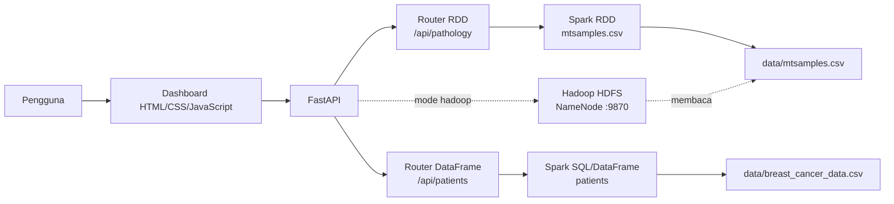
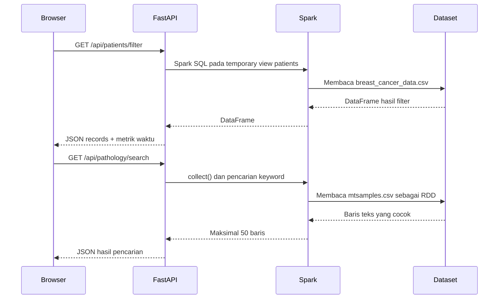

# Hybrid Spark & Hadoop Dashboard

Dashboard analitik data medis berbasis **FastAPI**, **Apache Spark** dan
**Hadoop HDFS**. Aplikasi ini menyediakan antarmuka web sederhana untuk:

- memfilter data pasien kanker menggunakan Spark SQL/DataFrame;
- mencari kata kunci pada laporan patologi menggunakan Spark RDD;
- melihat preview data terstruktur dan tidak terstruktur;
- mengukur waktu eksekusi operasi analitik dari sisi API.

> **Status implementasi:** repository ini merupakan proyek demonstrasi/laboratorium.
> Mode aplikasi ditentukan langsung di `main.py` melalui `EXEC_MODE`. Agar seluruh
> endpoint dashboard berjalan, gunakan mode `spark`. Mode `hadoop` saat ini
> menginisialisasi koneksi HDFS, tetapi router analitik masih membutuhkan state
> Spark (`spark` dan `text_rdd`).

## Daftar Isi

- [Arsitektur](#arsitektur)
- [Teknologi](#teknologi)
- [Struktur Proyek](#struktur-proyek)
- [Dataset](#dataset)
- [Prasyarat](#prasyarat)
- [Instalasi](#instalasi)
- [Menjalankan Aplikasi](#menjalankan-aplikasi)
- [Mode Eksekusi](#mode-eksekusi)
- [Halaman Web](#halaman-web)
- [API Reference](#api-reference)
- [Contoh Penggunaan API](#contoh-penggunaan-api)
- [Docker Hadoop HDFS](#docker-hadoop-hdfs)
- [Troubleshooting](#troubleshooting)
- [Catatan Pengembangan](#catatan-pengembangan)
- [Lisensi](#lisensi)

## Arsitektur

### Diagram komponen



### Alur pemrosesan



## Analisis Arsitektur Proyek

### 1. Arsitektur Umum dan Alur Data

Struktur utama proyek adalah:

```text
.
├── data/
│   ├── breast_cancer_data.csv   # Data kanker tabular
│   └── mtsamples.csv            # Laporan patologi berbasis teks
├── routers/
│   ├── dataframe_api.py         # Endpoint DataFrame/Spark SQL
│   ├── rdd_api.py               # Endpoint RDD/pencarian teks
│   └── analytics_api.py         # Metrik waktu eksekusi
├── static/
│   ├── index.html               # Dashboard utama
│   └── tables.html              # Preview data mentah
├── main.py                      # Entry point FastAPI dan pemilih mode
├── docker-compose.yml           # Infrastruktur Hadoop HDFS
└── README.md
```

Komponen aplikasi dan aliran datanya:

```text
+----------------------+       HTTP       +----------------------+
| Browser              | ----------------> | FastAPI / Uvicorn    |
| static/*.html        |                  | main.py              |
+----------------------+                  +----------+-----------+
                                                   |
                              +--------------------+--------------------+
                              |                                         |
                              v                                         v
                    +----------------------+                  +----------------------+
                    | dataframe_api.py     |                  | rdd_api.py           |
                    | /api/patients/*      |                  | /api/pathology/*    |
                    +----------+-----------+                  +----------+-----------+
                               |                                         |
                               v                                         v
                    breast_cancer_data.csv                     mtsamples.csv
                    DataFrame / pandas                         RDD / list teks
                               |                                         |
                               +--------------------+--------------------+
                                                    v
                                           JSON response + metrics
```

- `breast_cancer_data.csv` berisi data terstruktur dengan kolom seperti
  `id`, `diagnosis`, `radius_mean`, dan fitur tumor lainnya.
- `mtsamples.csv` berisi laporan patologi, transkripsi, spesialisasi medis,
  dan keywords.
- `main.py` membuat aplikasi FastAPI, membaca `EXEC_MODE`, lalu menginisialisasi
  Spark atau koneksi HDFS.
- `dataframe_api.py` menangani filter diagnosis/radius dan preview pasien.
- `rdd_api.py` menangani pencarian keyword dan preview baris laporan patologi.
- `analytics_api.py` menyimpan jumlah, rata-rata, dan waktu eksekusi terakhir
  secara in-memory selama proses aplikasi berjalan.

Pada mode Spark, aliran input lokalnya adalah:

```text
data/breast_cancer_data.csv --> Spark DataFrame --> temporary view "patients"
                                                    |
                                                    v
                                  Spark SQL --> toPandas() --> JSON

data/mtsamples.csv -----------> Spark RDD[String] --> collect/take
                                                    |
                                                    v
                                      pencarian keyword --> JSON
```

Pada mode Hadoop, aplikasi membaca dataset dari HDFS. Jika HDFS tidak dapat
diakses, `main.py` menggunakan file lokal di `data/` sebagai fallback:

```text
HDFS /data/*.csv --> hdfs.InsecureClient --> list teks/pandas DataFrame --> JSON
        ^
        | fallback jika gagal
data/*.csv lokal --------------------------------+
```

### 2. Arsitektur Pemrosesan Mode Spark

Mode Spark diaktifkan dengan `EXEC_MODE=spark`. `main.py` membuat
`SparkSession` menggunakan `local[1]`, sehingga Spark berjalan pada satu
mesin dan satu thread komputasi:

```text
+------------------------------------------------------+
| Proses FastAPI / Uvicorn                             |
|                                                      |
|  +-------------------+                               |
|  | Spark Driver      |                               |
|  | SparkSession      |                               |
|  | SparkContext      |                               |
|  +---------+---------+                               |
|            | local scheduler                         |
|            v                                         |
|  +-------------------+                               |
|  | Local executor    |                               |
|  | local[1]          |                               |
|  +-------------------+                               |
+------------------------------------------------------+
```

Tidak ada Spark Master eksternal, Spark Worker, atau executor terpisah pada
repository ini. Dengan kata lain, `local[1]` adalah local mode, bukan Spark
cluster deployment.

#### Alur DataFrame dan Spark SQL

1. `spark.read.csv(..., header=True, inferSchema=True)` membaca
   `breast_cancer_data.csv`.
2. Data dibentuk menjadi Spark DataFrame.
3. DataFrame didaftarkan sebagai temporary view bernama `patients`.
4. Endpoint `/api/patients/filter` menjalankan query SQL untuk memfilter
   `diagnosis` dan `radius_mean`.
5. Endpoint memanggil `toPandas()`, mengubah hasil ke dictionary, lalu
   mengembalikannya sebagai JSON.

```text
CSV --> Spark CSV Reader --> DataFrame --> SQL view "patients"
                                             |
                                             v
                             SELECT/filter --> toPandas() --> JSON
```

#### Alur RDD

1. `spark.sparkContext.textFile("data/mtsamples.csv")` membuat
   `RDD[String]`.
2. `/api/pathology/all` menggunakan `take(limit)`.
3. `/api/pathology/search` menggunakan `collect()`, kemudian pencarian
   keyword dilakukan oleh Python driver.
4. Hasil pencarian dibatasi maksimal 50 baris.

```text
mtsamples.csv --> RDD[String] --> collect()
                                      |
                                      v
                         Python list comprehension
                         keyword in line.lower()
                                      |
                                      v
                              maksimal 50 hasil
```

Implementasi pencarian saat ini belum menggunakan transformasi
`text_rdd.filter(...)`; seluruh baris dikumpulkan ke driver terlebih dahulu.
Karena itu pendekatan ini cocok untuk demonstrasi, tetapi kurang ideal untuk
dataset teks yang sangat besar.

### 3. Infrastruktur Hadoop melalui Docker Compose

`docker-compose.yml` hanya mendefinisikan dua service HDFS:

| Service | Peran | Port host |
|---|---|---|
| `namenode` | Metadata HDFS, RPC, dan Web UI/WebHDFS | `9870`, `9000` |
| `datanode` | Penyimpanan blok data HDFS | `9864` |

Tidak ada YARN ResourceManager, NodeManager, Hadoop History Server, Spark
Master, atau Spark Worker dalam Compose ini. Jadi konfigurasi tersebut adalah
HDFS minimal, bukan cluster Hadoop lengkap berbasis YARN.

```text
                         Host
              +-------------------------+
              | FastAPI / Uvicorn       |
              | InsecureClient          |
              +------------+------------+
                           |
                           | http://localhost:9870
                           v
+----------------------------------------------------------------+
| Docker network                                                 |
|                                                                |
|  +-----------------------+      hdfs://namenode:9000           |
|  | namenode              | <----------------------------------+
|  | NameNode              |                                    |
|  | Web UI: 9870          |                                    |
|  | RPC: 9000             |                                    |
|  +-----------+-----------+                                    |
|              | metadata dan koordinasi blok                   |
|              v                                                 |
|  +-----------------------+                                    |
|  | datanode              |                                    |
|  | DataNode              |                                    |
|  | Web UI: 9864          |                                    |
|  +-----------------------+                                    |
+----------------------------------------------------------------+
```

Detail komunikasi:

- Kedua container berada pada network default Docker Compose.
- `datanode` menemukan NameNode melalui hostname `namenode`.
- `CORE_CONF_fs_defaultFS=hdfs://namenode:9000` menetapkan NameNode sebagai
  filesystem default.
- `SERVICE_PRECONDITION=namenode:9870` membuat DataNode menunggu NameNode
  siap.
- Named volume `hadoop_namenode` menyimpan metadata NameNode.
- Named volume `hadoop_datanode` menyimpan blok data DataNode.
- Folder host `data/` tidak otomatis dimount ke container dan tidak otomatis
  masuk HDFS.

Dataset harus dimasukkan ke HDFS secara manual, misalnya:

```text
data/*.csv di host
       |
       | docker cp
       v
file sementara di container namenode
       |
       | hdfs dfs -put
       v
HDFS:
  /data/mtsamples.csv
  /data/breast_cancer_data.csv
```

Contoh perintah:

```powershell
docker cp data\mtsamples.csv namenode:/tmp/mtsamples.csv
docker cp data\breast_cancer_data.csv namenode:/tmp/breast_cancer_data.csv
docker exec namenode hdfs dfs -mkdir -p /data
docker exec namenode hdfs dfs -put -f /tmp/mtsamples.csv /data/
docker exec namenode hdfs dfs -put -f /tmp/breast_cancer_data.csv /data/
```

Dalam mode Hadoop, `InsecureClient("http://localhost:9870", user="root")`
membaca file melalui NameNode/WebHDFS. NameNode mengelola metadata dan lokasi
blok, sedangkan isi blok disimpan oleh DataNode. Setelah dibaca, pemrosesan
berlangsung di memori proses FastAPI menggunakan list Python dan pandas; tidak
ada job MapReduce atau Spark-on-YARN.

## Teknologi

| Komponen | Peran |
|---|---|
| Python | Bahasa pemrograman utama |
| FastAPI | REST API dan routing |
| Uvicorn | Application server ASGI |
| PySpark | Pemrosesan DataFrame, Spark SQL, dan RDD |
| Hadoop HDFS | Penyimpanan/akses data terdistribusi opsional |
| `hdfs` | Client Python untuk HDFS |
| HTML, CSS, JavaScript | Dashboard frontend |
| Docker Compose | Menjalankan NameNode dan DataNode |

## Struktur Proyek

```text
.
├── data/
│   ├── breast_cancer_data.csv    # Data kanker berbentuk tabular
│   └── mtsamples.csv             # Laporan patologi berbentuk teks
├── routers/
│   ├── dataframe_api.py          # Endpoint Spark SQL/DataFrame
│   └── rdd_api.py                # Endpoint Spark RDD
├── static/
│   ├── index.html                # Dashboard analitik
│   └── tables.html               # Preview data mentah
├── docker-compose.yml            # Konfigurasi Hadoop HDFS
├── main.py                       # Inisialisasi FastAPI dan Spark/HDFS
└── README.md
```

## Dataset

### `data/breast_cancer_data.csv`

Dataset tabular dengan kolom utama:

- `id`: identitas sampel;
- `diagnosis`: `M` untuk malignant dan `B` untuk benign;
- `radius_mean`: nilai radius rata-rata;
- kolom fitur tumor lainnya seperti `texture_mean`, `area_mean`,
  `smoothness_mean`, dan fitur `*_worst`.

File ini dibaca oleh Spark dengan `header=True` dan `inferSchema=True`, lalu
daftarkan sebagai temporary view bernama `patients`.

### `data/mtsamples.csv`

Dataset laporan medis tidak terstruktur. Kolom yang tersedia antara lain
`description`, `medical_specialty`, `sample_name`, `transcription`, dan
`keywords`. File ini dimuat sebagai RDD berbasis baris teks untuk pencarian
keyword.

## Prasyarat

- Python 3.10+;
- Java yang kompatibel dengan versi PySpark yang digunakan;
- Apache Spark/PySpark;
- Docker Desktop dan Docker Compose, hanya jika ingin menjalankan HDFS;
- Windows: konfigurasi Spark lokal dapat memerlukan `winutils` sesuai versi
  Hadoop yang dipakai.

Repository belum menyediakan `requirements.txt`. Instal dependensi Python
secara manual:

```powershell
python -m venv venv
.\venv\Scripts\Activate.ps1
python -m pip install --upgrade pip
pip install fastapi uvicorn pyspark hdfs
```

Jika PowerShell menolak aktivasi environment, jalankan:

```powershell
Set-ExecutionPolicy -Scope Process -ExecutionPolicy Bypass
.\venv\Scripts\Activate.ps1
```

## Instalasi

1. Clone repository dan masuk ke direktori proyek.
2. Buat serta aktifkan virtual environment.
3. Instal dependensi Python seperti pada bagian [Prasyarat](#prasyarat).
4. Pastikan dataset tersedia di direktori `data/`.
5. Untuk penggunaan mode Spark, ubah konfigurasi berikut di `main.py`:

   ```python
   EXEC_MODE = "spark"
   ```

## Menjalankan Aplikasi

Jalankan server dari root repository:

```powershell
python -m uvicorn main:app --reload
```

Buka halaman berikut di browser:

- Dashboard: <http://localhost:8000/>
- Tabel data: <http://localhost:8000/tables>
- Dokumentasi Swagger: <http://localhost:8000/docs>
- Dokumentasi ReDoc: <http://localhost:8000/redoc>

Spark dijalankan dalam `local[1]` agar lebih stabil pada Windows. Konfigurasi
Arrow juga dimatikan di `main.py` untuk menghindari masalah konversi Pandas.

## Mode Eksekusi

### Mode `spark`

Mode ini:

1. membuat `SparkSession` lokal;
2. memuat `data/mtsamples.csv` sebagai `text_rdd`;
3. memuat `data/breast_cancer_data.csv` sebagai DataFrame;
4. membuat temporary view SQL bernama `patients`;
5. mengaktifkan endpoint DataFrame dan RDD.

Gunakan mode ini untuk menjalankan dashboard secara lengkap.

### Mode `hadoop`

Mode ini membuat `InsecureClient` ke:

```text
http://localhost:9870
```

dan mencoba membaca `/data/mtsamples.csv` dari HDFS. Dataset harus sudah
tersedia di HDFS. Pada implementasi saat ini, mode ini belum membuat
`SparkSession` dan `text_rdd`, sehingga endpoint analitik dashboard belum dapat
digunakan sepenuhnya tanpa pengembangan lanjutan pada `main.py`.

## Halaman Web

### Dashboard utama `/`

Dashboard memiliki dua panel:

1. **Filter Rekam Medis (DataFrame)**  
   Memfilter pasien berdasarkan diagnosis dan batas minimum `radius_mean`.
2. **Pencarian Teks Patologi (RDD)**  
   Mencari keyword pada baris laporan patologi dan menampilkan maksimal 50
   hasil.

Kedua panel otomatis memuat data ketika halaman dibuka.

### Tabel data `/tables`

Menampilkan:

- maksimal 100 baris data pasien dari endpoint DataFrame;
- maksimal 100 baris data laporan patologi dari endpoint RDD.

## API Reference

Semua endpoint mengembalikan JSON. Jika terjadi kegagalan pemrosesan, API
mengembalikan HTTP `500` dengan field `detail`.

### DataFrame API

#### `GET /api/patients/filter`

Parameter query:

| Parameter | Tipe | Default | Keterangan |
|---|---|---:|---|
| `min_radius` | float | `20.0` | Nilai minimum `radius_mean` |
| `diag_type` | string | `M` | Diagnosis, umumnya `M` atau `B` |

Response berisi `execution_time_sec`, `total_found`, dan `data`.

#### `GET /api/patients/all`

Parameter query:

| Parameter | Tipe | Default | Keterangan |
|---|---|---:|---|
| `limit` | integer | `100` | Jumlah baris maksimum |

Response berisi `columns` dan `data`.

### RDD API

#### `GET /api/pathology/search`

Parameter query:

| Parameter | Tipe | Default | Keterangan |
|---|---|---:|---|
| `keyword` | string | `cancer` | Teks yang dicari tanpa membedakan kapitalisasi |

Response berisi `execution_time_sec`, `keyword`, dan maksimal 50 baris pada
`data`.

#### `GET /api/pathology/all`

Parameter query:

| Parameter | Tipe | Default | Keterangan |
|---|---|---:|---|
| `limit` | integer | `100` | Jumlah baris maksimum |

Response berisi `data` berupa baris teks.

## Contoh Penggunaan API

```powershell
# Filter pasien malignant dengan radius minimum 20
curl "http://localhost:8000/api/patients/filter?min_radius=20&diag_type=M"

# Ambil 10 baris data pasien
curl "http://localhost:8000/api/patients/all?limit=10"

# Cari keyword pada laporan patologi
curl "http://localhost:8000/api/pathology/search?keyword=tumor"

# Ambil 20 baris pertama RDD
curl "http://localhost:8000/api/pathology/all?limit=20"
```

## Docker Hadoop HDFS

Jalankan cluster HDFS:

```powershell
docker compose up -d
docker compose ps
```

Antarmuka NameNode tersedia di <http://localhost:9870>. Untuk memasukkan
dataset ke HDFS, gunakan shell container NameNode:

```powershell
docker exec -it namenode bash
mkdir -p /data
hdfs dfs -put -f /path/di/container/mtsamples.csv /data/mtsamples.csv
hdfs dfs -ls /data
exit
```

Perintah `hdfs dfs -put` harus dijalankan terhadap file yang memang tersedia
di dalam container. Jika file masih berada di host, salin terlebih dahulu
dengan `docker cp`.

Hentikan layanan HDFS dengan:

```powershell
docker compose down
```

## Troubleshooting

### `AttributeError: 'State' object has no attribute 'spark'`

Pastikan `EXEC_MODE = "spark"` di `main.py`, lalu restart Uvicorn.

### `Java gateway process exited before sending its port number`

Periksa instalasi Java dan variabel `JAVA_HOME`. Pastikan versi Java cocok
dengan PySpark yang terpasang dan jalankan ulang virtual environment.

### HDFS tidak dapat diakses di port `9870`

Pastikan container berjalan:

```powershell
docker compose ps
docker compose logs namenode
```

Pastikan juga port `9870` tidak sedang digunakan aplikasi lain.

### Hasil API terlalu besar atau proses lambat

Gunakan parameter `limit` untuk endpoint `/all`. Endpoint pencarian RDD
mengumpulkan data dengan `collect()` dan membatasi response menjadi 50 baris,
tetapi tetap dapat memakai memori besar jika dataset bertambah signifikan.

## Catatan Pengembangan

- `main.py` saat ini menyimpan pilihan mode secara hard-coded melalui
  `EXEC_MODE`; konfigurasi environment variable dapat ditambahkan untuk
  deployment yang lebih fleksibel.
- Query DataFrame dibangun dari parameter request. Untuk penggunaan produksi,
  tambahkan validasi input dan gunakan pendekatan yang menghindari interpolasi
  SQL langsung.
- `toPandas()` cocok untuk preview berukuran kecil, bukan untuk mengirim
  keseluruhan dataset berukuran besar.
- File `__pycache__` dan environment lokal sebaiknya tidak di-commit ke
  repository.
- Tambahkan `requirements.txt` atau `pyproject.toml` agar instalasi dependency
  dapat direproduksi.

## Lisensi

Repository ini belum menyertakan berkas lisensi. Tambahkan lisensi proyek
secara eksplisit sebelum digunakan atau didistribusikan di luar kebutuhan
internal/pembelajaran.
